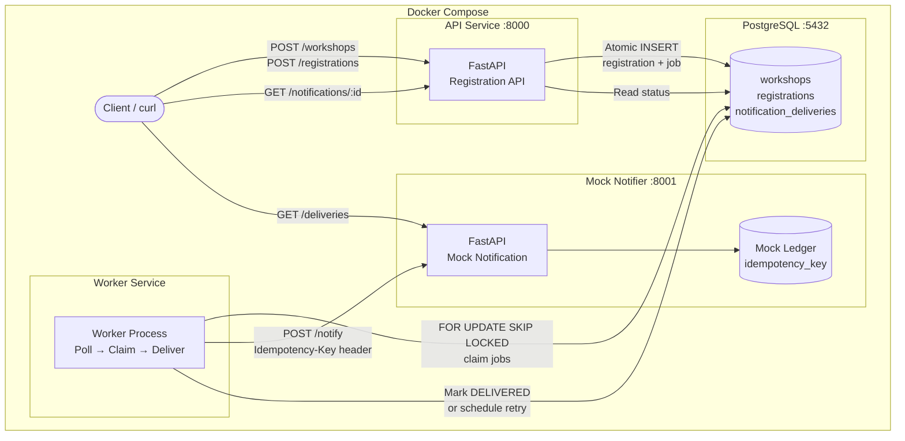
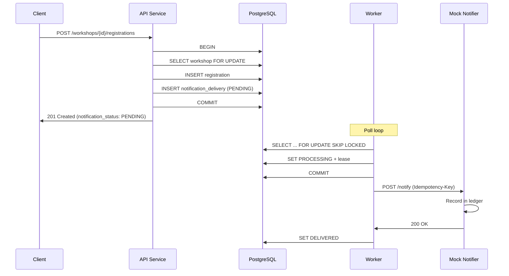
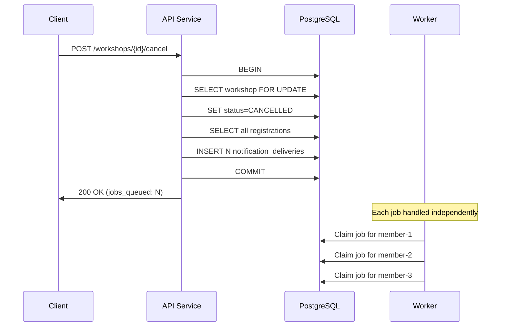
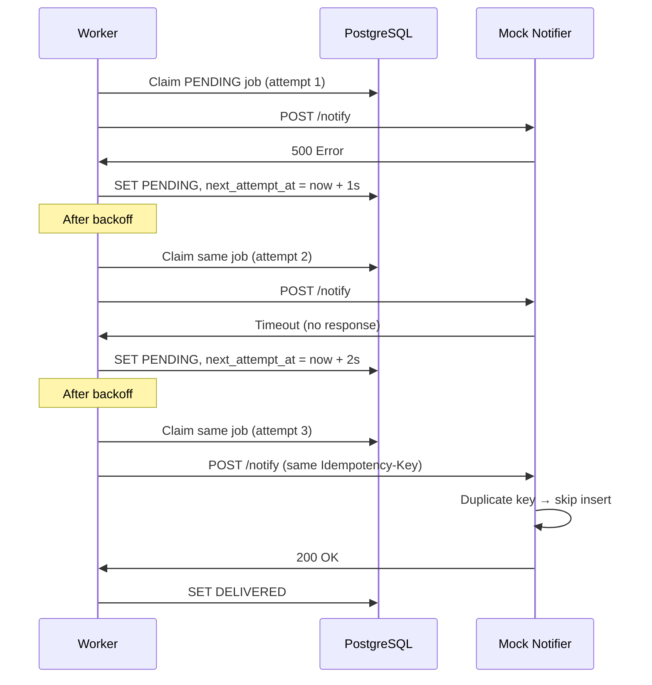

# Workshop Registration & Notifications Architecture

## System Overview

## Event Flow: Registration

## Event Flow: Cancellation

## Retry & Recovery Flow

## Data Model

| Table | Key Columns | Purpose |
|-------|-------------|---------|
| `workshops` | id, title, status (OPEN/CANCELLED), starts_at | Workshop registry |
| `registrations` | id, workshop_id, member_id (UNIQUE together) | Member enrollments |
| `notification_deliveries` | id, event_key (UNIQUE), status, attempt_count, locked_until | Transactional outbox / durable queue |
| `mock_deliveries` | idempotency_key (PK) | Mock notifier's delivery ledger |
